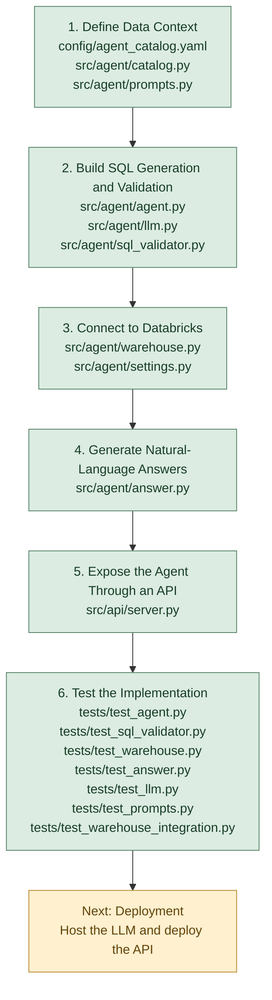

# SQL Agent: Development Timeline and Decisions

## Development Timeline

The milestones below summarize how the SQL agent was built. Files within each milestone represent the main components involved, not necessarily the exact order in which they were written.

## Architectural Decisions

### 1. Separate SQL Generation from Answer Generation

**Files:** `src/agent/agent.py`, `src/agent/answer.py`

The agent uses one LLM call to generate SQL and another to explain the query results in natural language.

**Why:** This separates query execution from explanation, making each stage easier to test and modify.

**Trade-off:** Two LLM calls increase latency and inference cost.

### 2. Restrict Queries Through a Catalog

**Files:** `config/agent_catalog.yaml`, `src/agent/catalog.py`, `src/agent/prompts.py`

The catalog defines the approved table, available columns, schema context, and query limits. The prompt uses this context to guide SQL generation.

**Why:** The model should query only the data it is intended to access instead of inventing tables or columns.

**Trade-off:** Schema changes require the catalog and related context to stay updated.

### 3. Validate SQL Before Execution

**Files:** `src/agent/sql_validator.py`, `src/agent/agent.py`

The validator restricts queries to a single `SELECT`, checks approved tables and columns, and enforces a maximum result limit.

**Why:** Model-generated SQL is untrusted input. Validation provides a deterministic safety check before execution.

**Trade-off:** Structural validation cannot guarantee that a query answers the question correctly or uses the right business logic.

### 4. Use Bounded Retries

**File:** `src/agent/agent.py`

The agent can retry failed queries up to three attempts, using validation or execution errors to guide corrections.

**Why:** A model may generate SQL with incorrect syntax or references on its first attempt.

**Trade-off:** Retries add latency and cannot reliably recover from external failures, such as unavailable services or exhausted compute capacity.

### 5. Separate Agent Logic from Infrastructure

**Files:** `src/agent/llm.py`, `src/agent/warehouse.py`, `src/agent/settings.py`

The agent depends on interfaces for the LLM and warehouse rather than directly embedding Ollama or Databricks connection logic.

**Why:** This allows the implementation to be tested with mock components and makes it easier to replace infrastructure later.

**Trade-off:** The additional interfaces and configuration introduce some setup complexity.

### 6. Ground Answers in Query Results

**File:** `src/agent/answer.py`

The answer generator receives the original question, executed SQL, query results, and relevant notes. It is instructed to explain only what the results support.

**Why:** The answer should reflect the actual data retrieved rather than general model knowledge.

**Trade-off:** Prompt instructions alone cannot eliminate hallucinations. Answers still require evaluation against known results, especially for numeric claims and predictions.

### 7. Expose the Agent Through a Flask API

**File:** `src/api/server.py`

The API provides `POST /ask` for questions and `GET /health` for a basic health check. It validates incoming requests and returns structured JSON responses.

**Why:** An API provides a consistent interface for a future frontend or other client.

**Trade-off:** The API adds another layer to test and requires deployment configuration before it can be used remotely.

### 8. Test Components Independently

**Files:** `tests/test_agent.py`, `tests/test_answer.py`, `tests/test_catalog.py`, `tests/test_llm.py`, `tests/test_prompts.py`, `tests/test_sql_validator.py`, `tests/test_warehouse.py`, `tests/test_warehouse_integration.py`

Unit tests use controlled inputs and mock dependencies to test agent behavior without requiring every test to call the live LLM or Databricks. The warehouse integration test checks the real connection path separately.

**Why:** Isolating components makes failures easier to diagnose and keeps most tests fast and repeatable.

**Trade-off:** Passing unit tests does not prove that the live model consistently generates correct SQL or accurate explanations.

### 9. Evaluate SQL Correctness

Files: `config/validation_set.yaml`, `scripts/evaluate_agent.py`

The evaluation layer defines fixed questions and reference SQL queries, executes both the reference and generated queries against Databricks, and compares their results.

Why: Measures whether the agent's generated SQL produces the expected results on representative questions.

Trade-off: Results can change as the underlying data changes.

## Future Improvements

The API and agent currently run locally. Deployment requires choosing a hosted LLM endpoint or hosting the model separately, configuring production credentials, and deploying the API.
